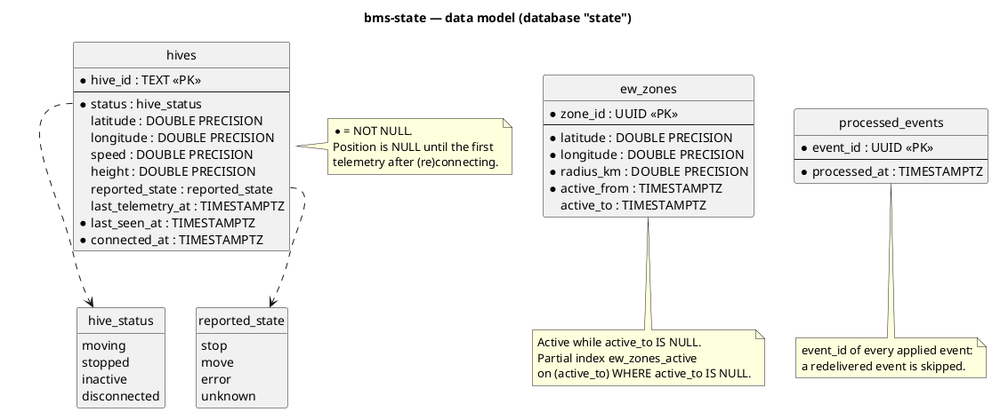
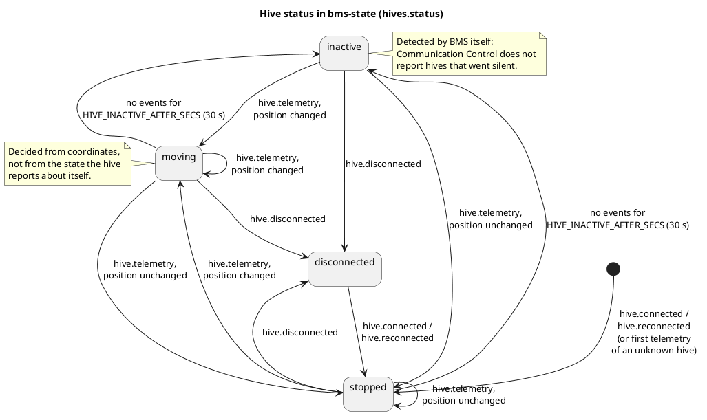
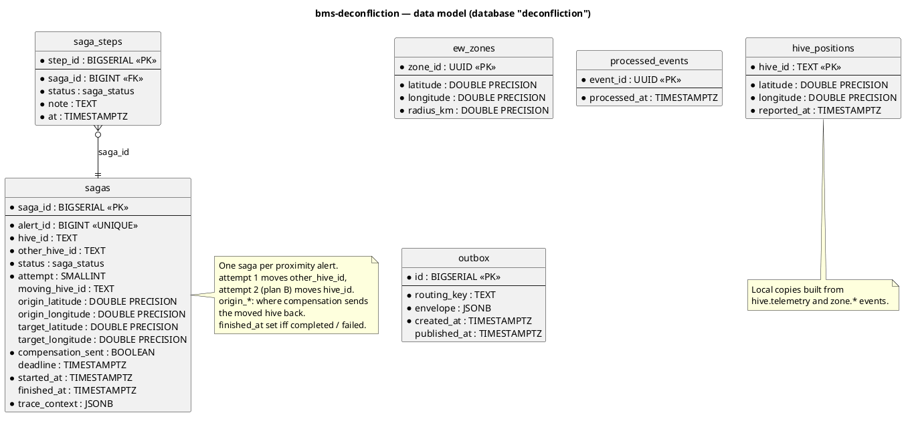
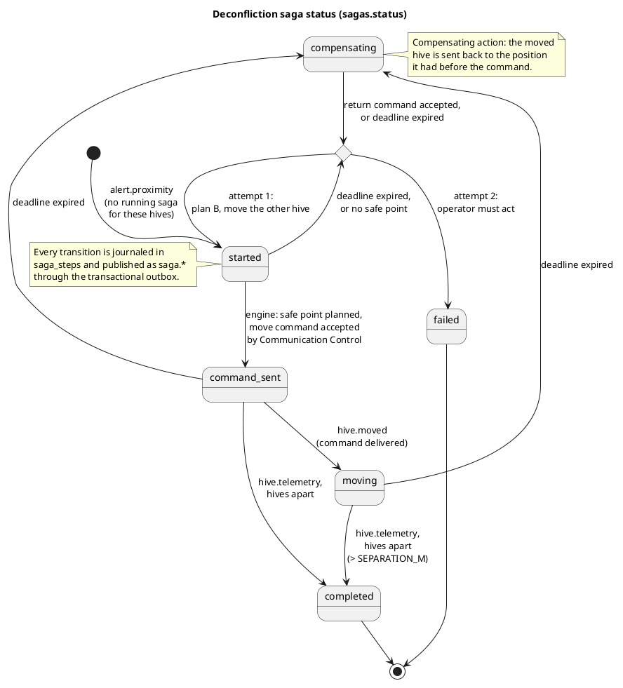

# BMS data model

Requirement BMS-3: the current state of HiveMind objects is stored in a database;
the data model is designed and documented in the project.

BMS follows database-per-service: one PostgreSQL 18 server, a separate database and
user for each service, and no service can connect to another service's database
(`infra/bms/postgres/init.sql`). Data a service needs from another one is copied
from events into its own database.

| Database        | Owner (user)        | Schema                                     |
|-----------------|---------------------|--------------------------------------------|
| `state`         | `bms_state`         | `crates/bms-state/migrations/`             |
| `deconfliction` | `bms_deconfliction` | `crates/bms-deconfliction/migrations/`     |

Migrations are embedded into each service binary and applied on startup (sqlx;
applied versions are recorded in `_sqlx_migrations`).

Two tables appear in both databases with the same meaning:

- **`processed_events`** — `event_id` of every applied event. RabbitMQ delivers at
  least once; an event is applied in one transaction together with inserting its id,
  so a redelivered event changes nothing (`bms_common::db::begin_event`).
- **`outbox`** — transactional outbox. Events about a change are inserted in the same
  transaction as the change; a relay publishes them to RabbitMQ and sets
  `published_at` (`bms_common::outbox`). A crash between publishing and marking
  republishes the event with the same `event_id`, which consumers recognize.

| Column         | Type          | Meaning                                    |
|----------------|---------------|--------------------------------------------|
| `id`           | `BIGSERIAL` PK | Publishing order                          |
| `routing_key`  | `TEXT`        | RabbitMQ routing key                       |
| `envelope`     | `JSONB`       | The event, as published                    |
| `created_at`   | `TIMESTAMPTZ` |                                            |
| `published_at` | `TIMESTAMPTZ` | NULL until the relay published the event   |

---

## Database `state` (service `bms-state`)

Writer: `bms-state`, from events of queue `bms.state` and its own monitoring.
Readers: the `bms-state` HTTP API (`/api/v1/...`).

### Types

| Type             | Values                                                                    |
|------------------|---------------------------------------------------------------------------|
| `hive_status`    | `moving`, `stopped`, `inactive`, `disconnected` — decided by BMS (BMS-2)  |
| `reported_state` | `stop`, `move`, `error`, `unknown` — reported by the hive itself          |
| `alert_kind`     | `zone_entered`, `proximity`                                               |
| `saga_status`    | `started`, `command_sent`, `moving`, `compensating`, `completed`, `failed` |

PostgreSQL `ENUM` types: stored in 4 bytes, read as words, other values are rejected.

### `hives` — current state of each hive (one row per hive)

| Column              | Type               | Null | Meaning |
|---------------------|--------------------|------|---------|
| `hive_id`           | `TEXT` PK          | no   | Hive identifier from Communication Control |
| `status`            | `hive_status`      | no   | `moving` / `stopped` from position changes; `inactive` after silence; `disconnected` by Communication Control |
| `latitude`          | `DOUBLE PRECISION` | yes  | Latest position; NULL until the first telemetry after (re)connecting |
| `longitude`         | `DOUBLE PRECISION` | yes  | |
| `speed`             | `DOUBLE PRECISION` | yes  | Latest reported speed |
| `height`            | `DOUBLE PRECISION` | yes  | Latest reported height |
| `reported_state`    | `reported_state`   | yes  | For reference only (an idle hive may report `move`) |
| `last_telemetry_at` | `TIMESTAMPTZ`      | yes  | Timestamp of the telemetry the row reflects; older telemetry is ignored |
| `last_seen_at`      | `TIMESTAMPTZ`      | no   | When BMS last received any event about the hive |
| `connected_at`      | `TIMESTAMPTZ`      | no   | When the hive (re)connected |

The fact of crossing an EW zone (BMS-2) is not stored here but derived from open
`zone_entered` alerts; the API returns it as `ew_zone_ids`.

### `ew_zones` — history of EW zones (one row per zone)

| Column        | Type               | Null | Meaning |
|---------------|--------------------|------|---------|
| `zone_id`     | `UUID` PK          | no   | Zone identifier from Communication Control |
| `latitude`    | `DOUBLE PRECISION` | no   | Center of the zone |
| `longitude`   | `DOUBLE PRECISION` | no   | |
| `radius_km`   | `DOUBLE PRECISION` | no   | Radius, `> 0` |
| `active_from` | `TIMESTAMPTZ`      | no   | Start of activity: creation time in Communication Control |
| `active_to`   | `TIMESTAMPTZ`      | yes  | End of activity; **NULL while the zone is active** |

BMS-4 asks for "activity status (active / inactive) and time bounds (from / to)":
the status is derived (`active_to IS NULL`) rather than stored, so it cannot
contradict the bounds. `CHECK (active_to IS NULL OR active_to >= active_from)`;
partial index `ew_zones_active` on active zones.

### `alerts` — monitoring alerts (BMS-5, proximity)

| Column          | Type               | Null | Meaning |
|-----------------|--------------------|------|---------|
| `alert_id`      | `BIGSERIAL` PK     | no   | |
| `kind`          | `alert_kind`       | no   | |
| `hive_id`       | `TEXT` FK → hives  | no   | |
| `zone_id`       | `UUID` FK → ew_zones | yes | `zone_entered`: the zone the hive is inside |
| `other_hive_id` | `TEXT` FK → hives  | yes  | `proximity`: the other hive (`hive_id < other_hive_id`) |
| `distance_m`    | `DOUBLE PRECISION` | yes  | `proximity`: distance at detection |
| `raised_at`     | `TIMESTAMPTZ`      | no   | |
| `resolved_at`   | `TIMESTAMPTZ`      | yes  | **NULL while the alert is open** |

Constraints: the columns required by each kind (`CHECK`); a proximity pair is stored
ordered, so (1, 2) and (2, 1) are one alert; unique partial indexes allow at most one
open alert per (hive, zone) and per pair.

### `sagas` — read copy of deconfliction sagas

| Column           | Type          | Null | Meaning |
|------------------|---------------|------|---------|
| `saga_id`        | `BIGINT` PK   | no   | Saga id in `bms-deconfliction` |
| `alert_id`       | `BIGINT`      | no   | Proximity alert that started the saga |
| `hive_id`        | `TEXT`        | no   | |
| `other_hive_id`  | `TEXT`        | no   | |
| `status`         | `saga_status` | no   | Latest reported status |
| `moving_hive_id` | `TEXT`        | yes  | Hive commanded in the current attempt |
| `note`           | `TEXT`        | no   | Reason of the latest change |
| `updated_at`     | `TIMESTAMPTZ` | no   | Time of the latest `saga.*` event; older events are ignored |

### How the state changes

All changes caused by one event happen in one transaction with the
`processed_events` insert.

| Event (routing key) | Effect |
|---------------------|--------|
| `hive.connected`, `hive.reconnected` | Upsert hive: `stopped`, position and telemetry reset to NULL; hive leaves all zones and close pairs |
| `hive.telemetry` | Upsert hive: position, speed, height, reported state; `moving` if the position changed by more than 1e-7°, otherwise `stopped`. Skipped if older than `last_telemetry_at`; an unknown hive is created. Then the monitoring checks of this hive |
| `hive.disconnected` | `disconnected`; its proximity alerts are resolved |
| `hive.moved`, `hive.stopped` | No change (movement is seen in telemetry) |
| `zone.activated` | Insert zone; then EW zone check of all hives |
| `zone.deactivated` | `active_to` = event time; then EW zone check of all hives |
| `zone.snapshot` | Insert missing zones, close active zones absent from the snapshot; then EW zone check of all hives |
| `saga.*` | Upsert the saga copy |

Monitoring (`bms-state/src/monitoring.rs`), inside the same transaction:

- **EW zones:** a hive is inside a zone when its great-circle distance (haversine) to
  the zone center is at most the radius. Entering opens a `zone_entered` alert and
  publishes `alert.zone_entered`; leaving resolves it.
- **Proximity:** active hives (`moving` / `stopped`) closer than
  `PROXIMITY_THRESHOLD_M` (500 m) open a `proximity` alert and publish
  `alert.proximity` with both positions. The alert is resolved above 600 m
  (hysteresis, ×1.2), or when one of the hives is no longer active.

A background task marks hives `inactive` every 5 s when nothing was heard from them
for `HIVE_INACTIVE_AFTER_SECS` (default 30 s, as in CC-7) and resolves their
proximity alerts. Their next telemetry makes them `moving` or `stopped` again.

---

## Database `deconfliction` (service `bms-deconfliction`)

Writer and reader: `bms-deconfliction` only.

### Local copies (built from events)

| Table            | From             | Content |
|------------------|------------------|---------|
| `hive_positions` | `hive.telemetry` | Latest position of each hive (`hive_id` PK, `latitude`, `longitude`, `reported_at`); older telemetry ignored |
| `ew_zones`       | `zone.*`         | Zones active now (`zone_id` PK, `latitude`, `longitude`, `radius_km`); a deactivated zone is deleted |

A different shape than in `state` on purpose: the saga needs only current
positions and active zones, no statuses and no history.

### `sagas` — deconfliction sagas

| Column              | Type               | Null | Meaning |
|---------------------|--------------------|------|---------|
| `saga_id`           | `BIGSERIAL` PK     | no   | |
| `alert_id`          | `BIGINT` UNIQUE    | no   | Proximity alert of `bms-state`: one saga per alert |
| `hive_id`           | `TEXT`             | no   | The close pair |
| `other_hive_id`     | `TEXT`             | no   | |
| `status`            | `saga_status`      | no   | See the diagram below |
| `attempt`           | `SMALLINT`         | no   | 1: move `other_hive_id`; 2 (plan B): move `hive_id` |
| `moving_hive_id`    | `TEXT`             | yes  | Hive commanded in the current attempt |
| `origin_latitude`   | `DOUBLE PRECISION` | yes  | Its position before the command: where compensation sends it back |
| `origin_longitude`  | `DOUBLE PRECISION` | yes  | |
| `target_latitude`   | `DOUBLE PRECISION` | yes  | Safe point it was sent to |
| `target_longitude`  | `DOUBLE PRECISION` | yes  | |
| `compensation_sent` | `BOOLEAN`          | no   | The return command was accepted in the current attempt |
| `deadline`          | `TIMESTAMPTZ`      | yes  | The current step must finish by then; NULL when finished |
| `started_at`        | `TIMESTAMPTZ`      | no   | |
| `finished_at`       | `TIMESTAMPTZ`      | yes  | Set exactly for `completed` and `failed` (`CHECK`) |
| `trace_context`     | `JSONB`            | no   | W3C trace context of the alert; the engine continues its trace (migration 0003) |

### `saga_steps` — journal of every saga transition

`step_id` (`BIGSERIAL` PK), `saga_id` (FK → sagas), `status`, `note`, `at`.

### Saga

| Trigger | Transition |
|---------|------------|
| `alert.proximity` | New saga `started` (attempt 1), unless one of the hives is in a running saga |
| Engine, every second | `started`: plan a safe point (`SAFE_DISTANCE_M` = 1000 m from the other hive, away from it, inside the operational area, outside EW zones; turning by ±30° if needed), send the move command → `command_sent` |
| `hive.moved` of the moving hive | `command_sent` → `moving` |
| `hive.telemetry` of either hive | Hives farther apart than `SEPARATION_M` (600 m) → `completed` |
| Deadline expired in `command_sent` / `moving` | → `compensating`: the engine sends the moved hive back to its origin |
| Return command accepted, or deadline expired in `compensating` / `started`, or no safe point | Attempt 1 → plan B (`started`, attempt 2); attempt 2 → `failed` |

Deadlines: `COMMAND_TIMEOUT_SECS` (15 s) to deliver a command,
`SEPARATION_TIMEOUT_SECS` (120 s) to move apart. Every transition is journaled in
`saga_steps` and published as `saga.<status>` through the outbox.

---

## Guarantees

- **No duplicates:** a redelivered event is skipped (`processed_events`); one saga
  per alert (`UNIQUE`), one open alert per hive and zone or pair (unique indexes).
- **No partial updates:** an event is applied completely or not at all (transaction).
- **No lost or phantom events:** events about a change are published if and only if
  the change is committed (transactional outbox).
- **No going back in time:** telemetry older than the stored one does not overwrite it.
- **Self-healing:** a hive missed while BMS was down appears with its first telemetry;
  zones changed while `bms-ingest` was down are reconciled by the startup snapshot;
  a saga survives a restart of its service (state and deadlines are in the database).

## Limitations

- **Clock skew:** event times come from the `bms-ingest` clock, zone start times from
  the Communication Control clock, inactivity checks and saga deadlines use the
  database clock. Small differences are harmless with the configured timeouts; a zone
  end uses `GREATEST(active_from, …)` so it never precedes its start.
- **Zone end time precision:** up to the polling interval (2 s); for zones deleted while
  `bms-ingest` was down, the time of the reconciling snapshot.
- **Compensation is best effort:** the return command is accepted by Communication
  Control, but cannot be delivered to a hive that is down.
- **Single instance per service:** the outbox relay assumes one instance; with several,
  rows would be claimed with `SELECT … FOR UPDATE SKIP LOCKED`.
- **`processed_events` and `outbox` grow** with every event; in production old rows
  would be deleted periodically.
